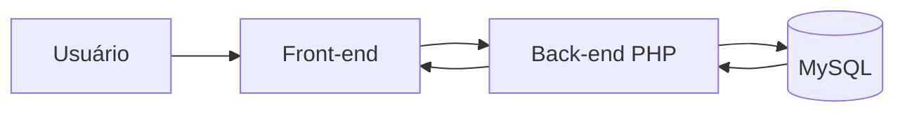

# 👥 Human Resources Management


## 📌 Sobre o projeto

O **Human Resources Management (HRM)** é um sistema web Full Stack desenvolvido para centralizar, automatizar e otimizar processos relacionados à gestão de Recursos Humanos.

A plataforma busca solucionar problemas relacionados à descentralização de informações, ao retrabalho operacional e à dificuldade de acompanhamento de indicadores organizacionais.

Por meio de uma interface integrada, o sistema permite gerenciar informações corporativas e apoiar a tomada de decisões estratégicas do setor de RH.

## 🎯 Objetivos

- Centralizar informações de Recursos Humanos.
- Automatizar processos administrativos.
- Reduzir o retrabalho operacional.
- Facilitar o acompanhamento do quadro de colaboradores.
- Disponibilizar indicadores financeiros e organizacionais.
- Melhorar a organização e a gestão das informações.

## ⚙️ Funcionalidades

### 🔐 Autenticação e usuários

- Autenticação de usuários.
- Gerenciamento de sessões.
- Controle de acesso.
- Cadastro e edição de usuários.
- Gerenciamento de perfis.

### 👥 Gestão de colaboradores

- Cadastro e gerenciamento de colaboradores.
- Edição de informações pessoais e profissionais.
- Gerenciamento de vínculos trabalhistas.
- Associação de colaboradores às empresas.
- Consulta de informações cadastrais.

### 🏢 Gestão de empresas

- Cadastro e edição de empresas.
- Gerenciamento de informações corporativas.
- Organização de colaboradores por empresa.

### 💰 Gestão financeira e benefícios

- Gerenciamento de benefícios.
- Associação de benefícios aos colaboradores.
- Controle de informações salariais.
- Visualização dos custos por colaborador.
- Acompanhamento de despesas organizacionais.

### 📊 Dashboard gerencial

- Indicadores de Recursos Humanos.
- Visualização de dados por meio de gráficos.
- Acompanhamento de gastos gerais.
- Consolidação de informações organizacionais.
- Apoio à tomada de decisões.

### 🕒 Controle de frequência

- Gerenciamento de registros de ponto.
- Acompanhamento da frequência dos colaboradores.
- Proposta de integração com dispositivos ESP32 e RFID.

### 🎨 Personalização

- Personalização da experiência do usuário.
- Configuração de elementos visuais da plataforma.

## 🛠️ Tecnologias utilizadas

| Tecnologia | Aplicação |
|------------|-----------|
| HTML5 | Estruturação das interfaces |
| CSS3 | Estilização e layout |
| JavaScript | Interatividade e manipulação do DOM |
| PHP | Processamento Back-end e regras de negócio |
| MySQL | Armazenamento e gerenciamento de dados |
| JSON | Comunicação e transferência de dados |
| Git | Controle de versionamento |
| GitHub | Hospedagem e colaboração de código |

## 🏗️ Arquitetura do sistema

O sistema utiliza uma arquitetura cliente-servidor, integrando interfaces web, regras de negócio e um banco de dados relacional.



### Front-end

Responsável pela apresentação das informações, interfaces, formulários, gráficos e interações com os usuários.

### Back-end

Responsável pelo processamento das requisições, gerenciamento de sessões, regras de negócio e comunicação com o banco de dados.

### Banco de dados

Responsável pelo armazenamento e relacionamento das informações corporativas, garantindo a organização dos dados do sistema.

## 🗄️ Modelagem de dados

O banco de dados relacional contempla entidades relacionadas à gestão de Recursos Humanos, incluindo:

- Colaboradores;
- Empresas;
- Usuários;
- Vínculos trabalhistas;
- Benefícios;
- Relacionamentos entre colaboradores e benefícios.

A modelagem utiliza chaves primárias, chaves estrangeiras e relacionamentos entre entidades.

## 📂 Estrutura do repositório

```text
Human-Resources-Management/
│
├── RH Management/
├── rhUpdate/
└── README.md
```

## 🚀 Como executar o projeto

### Pré-requisitos

- PHP
- MySQL
- Servidor web Apache
- Git
- Ambiente local, como Laragon ou XAMPP

### 1. Clone o repositório

```bash
git clone https://github.com/Davi-Profeta/Human-Resources-Management.git
```

### 2. Configure o ambiente

Adicione os arquivos da versão desejada do projeto ao diretório do seu servidor web local.

### 3. Configure o banco de dados

- Crie um banco de dados MySQL.
- Importe os scripts SQL disponibilizados no projeto.
- Configure as credenciais no arquivo de conexão.
- Inicie os serviços Apache e MySQL.

### 4. Acesse o sistema

Abra o navegador e acesse o projeto por meio do localhost, utilizando o caminho correspondente à pasta configurada.

## 📚 Conhecimentos aplicados

Durante o desenvolvimento do projeto, foram aplicados conhecimentos em:

- Desenvolvimento Web Full Stack;
- Modelagem de banco de dados relacional;
- Linguagem SQL;
- Operações CRUD;
- Autenticação e gerenciamento de sessões;
- Integração entre Front-end e Back-end;
- Processamento de formulários;
- Manipulação do DOM;
- Comunicação de dados utilizando JSON;
- Desenvolvimento de dashboards;
- Controle de versionamento;
- Desenvolvimento colaborativo;
- Levantamento e análise de requisitos.

## 📈 Roadmap

- [ ] Consolidação dos módulos administrativos.
- [ ] Integração do controle de ponto com ESP32 e RFID.
- [ ] Gerenciamento de vagas.
- [ ] Gerenciamento de documentos e atestados.
- [ ] Gerenciamento de desligamentos.
- [ ] Aprimoramento dos indicadores gerenciais.
- [ ] Aprimoramento da segurança.
- [ ] Testes e validação do sistema.

## 👨‍💻 Equipe de desenvolvimento

Projeto desenvolvido por uma equipe de quatro integrantes como trabalho final do curso de Desenvolvimento Web — SENAI.

**Human Resources Management — Tecnologia aplicada à gestão estratégica de pessoas.**
